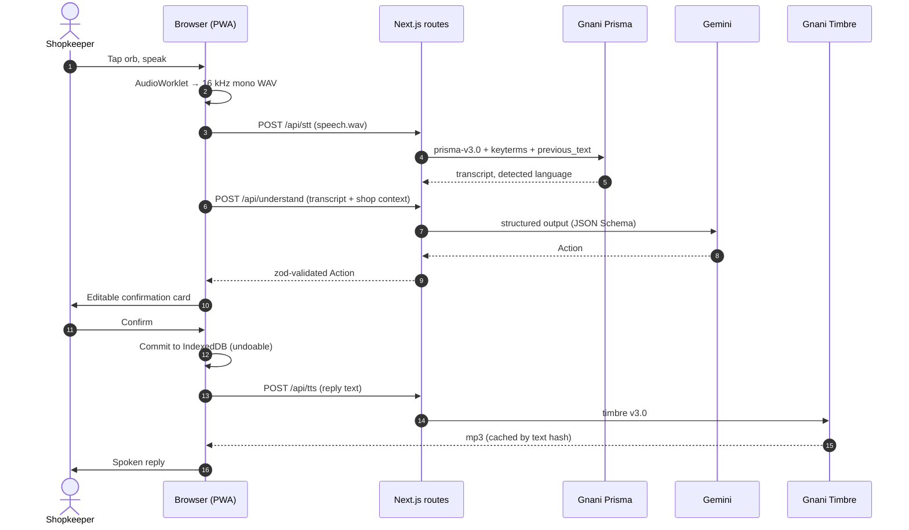

<div align="center">

<a href="https://dukaan-dost-rouge.vercel.app">
  
</a>

<br>

<a href="https://dukaan-dost-rouge.vercel.app">
  
</a>

<br><br>

[](https://dukaan-dost-rouge.vercel.app)


**[Live app](https://dukaan-dost-rouge.vercel.app)** ·
**[Try it in 60 s](#-try-it-in-60-seconds)** ·
**[What it does](#-what-it-does)** ·
**[How it works](#-how-it-works)** ·
**[Run locally](#-run-locally)** ·
**[Docs](#-docs)**

</div>


A kirana owner runs the whole shop alone, by memory and by hand: udhaar in a paper bahi-khata, stock by looking at the shelves, distributor orders over calls, customer orders as WhatsApp voice notes. Khata and billing apps expect typing, usually in English. **Dukaan Dost lets the owner run the shop by talking.** They speak in any of 10 Indian languages, or a code-mixed mix like Hinglish, and the app keeps the khata, tracks stock, sends reminders and distributor orders as voice notes, turns noisy customer voice orders into packing lists, and reads out the day's hisaab.

> Built for the **Gnani Great Indian AI Internship Challenge**.

<p align="center"></p>

## 🚀 Try it in 60 seconds

1. Open **[dukaan-dost-rouge.vercel.app](https://dukaan-dost-rouge.vercel.app)** on your phone (Chrome on Android works best) or on a desktop.
2. Pick your language from the tiles, which are labelled in their own script.
3. Choose **Load demo shop** to get synthetic customers, products and suppliers.
4. Tap the orb, say one of the lines below, and confirm the card.

<table>
<tr><th>Say this</th><th>Dost does this</th></tr>
<tr><td><code>Sharma ji ne do kilo chawal aur ek Surf liya, 340 udhaar likh do</code></td><td>Adds ₹340 to Sharma ji's khata, with the items</td></tr>
<tr><td><code>Sharma ji ne 500 diye</code></td><td>Records the payment and reads back the new balance</td></tr>
<tr><td><code>Sharma ji ka kitna baaki hai?</code></td><td>Says the outstanding amount out loud</td></tr>
<tr><td><code>Maggi khatam, Parle-G sirf do packet bacha</code></td><td>Updates stock and flags low items</td></tr>
<tr><td><code>Ek Maggi aur do Parle-G, 40 rupaye cash</code></td><td>Logs a cash sale for today's hisaab</td></tr>
</table>

> [!TIP]
> Every voice command becomes an **editable confirmation card** before anything is saved. Fix a name or an amount with one tap, then confirm.

<details>
<summary><b>🎧 Listen to the noisy test voice notes</b> (these are what the Orders module has to understand)</summary>
<br>

GitHub can't play audio inline, so each link opens the file in your browser's player.

| Sample | Language | Condition |
|---|---|---|
| [order-hi.wav](https://dukaan-dost-rouge.vercel.app/fixtures/samples/order-hi.wav) | Hindi | clean |
| [order-hi-noisy.wav](https://dukaan-dost-rouge.vercel.app/fixtures/samples/order-hi-noisy.wav) | Hindi | shop noise |
| [order-hinglish-long.wav](https://dukaan-dost-rouge.vercel.app/fixtures/samples/order-hinglish-long.wav) | Hinglish | long, gets chunked |
| [order-kn.wav](https://dukaan-dost-rouge.vercel.app/fixtures/samples/order-kn.wav) | Kannada | clean |
| [order-kn-noisy.wav](https://dukaan-dost-rouge.vercel.app/fixtures/samples/order-kn-noisy.wav) | Kannada | shop noise |
| [order-ta.wav](https://dukaan-dost-rouge.vercel.app/fixtures/samples/order-ta.wav) | Tamil | clean |

In the app, open **[Orders](https://dukaan-dost-rouge.vercel.app/orders)** and use **Try a sample** to run any of them through the pipeline.

</details>

<p align="center"></p>

## 🧩 What it does

Click a module to expand it. The **Open** links go to that screen in the live app. Your data lives only in your browser, so set up a shop (or load the demo) first.

<details open>
<summary><b>📒 Voice Khata</b> (credit ledger) · <a href="https://dukaan-dost-rouge.vercel.app/khata">Open</a></summary>
<br>

- Add udhaar, record payments and ask for balances just by speaking.
- Fuzzy, transliteration-aware name matching: "Sharma", "शर्मा" and "ಶರ್ಮಾ" are the same customer. An unknown name gets an "Add new customer?" option on the card.
- Customers are sorted by what they owe, with red (owes) and green (clear) pills. Each has a timeline that keeps the original transcript.
- When a payment clears a balance, you get confetti and the customer shows as *"हिसाब बराबर"* (settled).

</details>

<details>
<summary><b>🔔 Payment reminders in your own voice</b></summary>
<br>

- Record 10–20 s once during onboarding, and Gnani Voice Clone builds a voice embedding that stays on your device.
- **Remind** writes a short, polite note *in the customer's language*, with the amount spelled out in words, and speaks it in **your** voice. If there's no clone, it uses a Timbre voice.
- Share the voice note to WhatsApp through the Web Share API, or download it.

</details>

<details>
<summary><b>📦 Stock & reorder</b> · <a href="https://dukaan-dost-rouge.vercel.app/stock">Open</a> · <a href="https://dukaan-dost-rouge.vercel.app/stock/reorder">Reorder list</a></summary>
<br>

- Update stock by voice: "Maggi khatam", "do bori atta aaya". It understands kg, g, l, ml, packet, piece, dabba, bori and dozen.
- Each product has a stock bar and a low-stock badge, plus aliases like "Parle-G", "parle ji" and "पारले जी".
- The reorder list is grouped by distributor, with a suggested quantity you can edit.
- **Send voice note** writes the order *in the distributor's language*, which can differ from yours, and speaks it.
- Import your catalogue from CSV. Try the [sample file](public/samples/stock-sample.csv).

</details>

<details>
<summary><b>🛍️ Customer voice orders</b> · <a href="https://dukaan-dost-rouge.vercel.app/orders">Open</a></summary>
<br>

- Drop in a WhatsApp voice note (`.opus`, `.ogg`, `.m4a`, `.mp3`, `.wav`), record one in the app, or try a noisy sample.
- Long audio is resampled in the browser, split on silence into chunks of 25 s or less, transcribed in sequence with context carried across chunks, and joined back together.
- The result is a **packing checklist** that moves New → Packed → Delivered. When a delivered order has a known customer and prices, its total goes into that customer's khata as udhaar.

</details>

<details>
<summary><b>📊 Aaj ka Hisaab</b> (daily summary) · <a href="https://dukaan-dost-rouge.vercel.app/hisaab">Open</a></summary>
<br>

- Animated cards for cash sales, udhaar given, payments collected, net cash in, top customers owing, low stock and orders delivered.
- A 7-day chart of udhaar given vs collected.
- **Listen** (सुनें) reads you the day's summary in your language.

</details>

<details>
<summary><b>🧠 Shop memory</b> · <a href="https://dukaan-dost-rouge.vercel.app/memory">Open</a></summary>
<br>

- A searchable, linked timeline of everything that happened in the shop: *"Dost remembers"*.

</details>

<p align="center"></p>

## ⚙️ How it works



| Piece | What it does here |
|---|---|
| **Gnani Prisma v3.0** (STT) | Auto language detection and code-mixing. Per-shop `keyterms` bias it toward your customer and product names, and `previous_text` keeps context between turns |
| **Gnani Timbre v3.0** (TTS) | One assistant voice across all 10 languages, with numbers and currency written out as words |
| **Gnani Voice Clone** | Reminders spoken in the shopkeeper's own voice |
| **Google Gemini** | Turns a transcript plus shop context into exactly one typed **Action**, and writes messages in the target language. Output is structured JSON, validated with zod |
| **Dexie / IndexedDB** | All shop data stays on the device. No accounts, no server database |

<details>
<summary><b>🔁 Sequence diagram: one voice command, end to end</b></summary>
<br>



</details>

<details>
<summary><b>🗂️ Project layout</b></summary>
<br>

```text
src/
├── app/                 # App Router screens + API route handlers
│   ├── api/             # stt · understand · compose · tts · clone · tts-clone · health
│   ├── khata/ stock/ orders/ hisaab/ memory/ onboarding/ settings/
├── components/          # orb, voice sheet, action cards, charts, layout
├── hooks/               # useRecorder, useVoiceCommand, useSpeak, useShop…
├── lib/
│   ├── audio/           # WAV encoder, resampler, silence-aware chunker
│   ├── domain/          # ledger, stock, orders, summary, fuzzy match, keyterms, CSV
│   ├── db/              # Dexie schema, repo (commit/undo), demo seed
│   ├── gnani/           # client, error mapping, serial queue + backoff
│   ├── llm/             # Gemini client, prompts, Action schema
│   ├── server/          # per-IP caps, mock fixtures, TTS cache
│   └── i18n/            # 10 languages
└── messages/            # next-intl catalogues (bn en gu hi kn ml mr pa ta te)
```

</details>

<details>
<summary><b>🧪 Things we learned the hard way</b> (where the Gnani API differs from its docs)</summary>
<br>

- **Timbre's WAV has a streaming header** (`data` size `0xFFFFFFFF`), so the header length can't be trusted. We use mp3 for browser playback.
- **Cloned TTS needs `model: "vachana-vc-v1"`** set explicitly. Timbre models reject `speaker_embedding`.
- **Prisma rejects `.webm`** with `UNSUPPORTED_AUDIO_FORMAT`. That's why the browser records raw PCM through an AudioWorklet and encodes WAV itself.
- **The STT format is picked from the filename extension**, so WhatsApp `.opus` files are renamed to `.ogg` before upload.
- **Each STT request is limited to 30 s**, which is why long voice notes are chunked on silence at 25 s or less.
- `indic-auto` with `format=transcribe` returns English words in Latin script and amounts as digits (*"Sharma ji ने 2 किलो chawal … 340 रुपये"*), which is exactly what the parser needs.

</details>

<p align="center"></p>

## 💻 Run locally

```powershell
cp .env.example .env.local      # add GNANI_API_KEY and GEMINI_API_KEY
npm install
npm run dev                      # http://localhost:3000
```

> [!NOTE]
> No keys yet? Set `MOCK_MODE=1` in `.env.local`. The API routes then serve recorded fixtures, so you can work on the UI without spending any credits.

<details>
<summary><b>Environment variables</b></summary>
<br>

| Variable | Purpose |
|---|---|
| `GNANI_API_KEY` | Gnani key, sent as the `X-API-Key-ID` header. Used only on the server |
| `GNANI_BASE_URL` | Defaults to `https://api.vachana.ai` |
| `GEMINI_API_KEY` | Google AI Studio key |
| `GEMINI_FAST_MODEL` | Model for speech → action, where latency matters |
| `GEMINI_MODEL` | Model for writing messages, and the fallback |
| `MOCK_MODE` | `1` serves fixtures instead of calling Gnani or Gemini |
| `DAILY_STT_CAP_PER_IP` / `DAILY_TTS_CAP_PER_IP` | Per-IP daily caps that protect credits on the public demo |

</details>

<details>
<summary><b>Scripts</b></summary>
<br>

| Command | What it does |
|---|---|
| `npm run dev` | Start the dev server |
| `npm run build` | Production build (also type-checks) |
| `npm test` | Run the Vitest suite once |
| `npm run test:watch` | Run Vitest in watch mode |
| `npm run lint` | Run ESLint |

Python helpers (API smoke tests, fixture generation, eval):

```powershell
python -m venv .venv
.venv\Scripts\python -m pip install -r scripts\requirements.txt
.venv\Scripts\python scripts\smoke_gnani.py
```

</details>

## 🔒 Privacy & data

- API keys stay on the server, in Next.js route handlers. The browser never sees them.
- Shop data lives in IndexedDB on the device. There are no accounts and no cloud sync.
- **Synthetic data only.** No real phone numbers, Aadhaar, PAN or recorded calls are used anywhere in this repo or the demo.

## 📚 Docs

- PRD / spec: [.planning/specs/dukaan-dost.md](.planning/specs/dukaan-dost.md)
- Implementation plan: [.planning/plans/dukaan-dost.md](.planning/plans/dukaan-dost.md)
- Progress tracker: [PROGRESS.md](PROGRESS.md)

<div align="center">
<br>
<a href="https://dukaan-dost-rouge.vercel.app"></a>
<br><br>
<sub>Made for the kirana owners of India 🇮🇳 · <i>Bolo, dukaan chalao.</i></sub>
</div>
